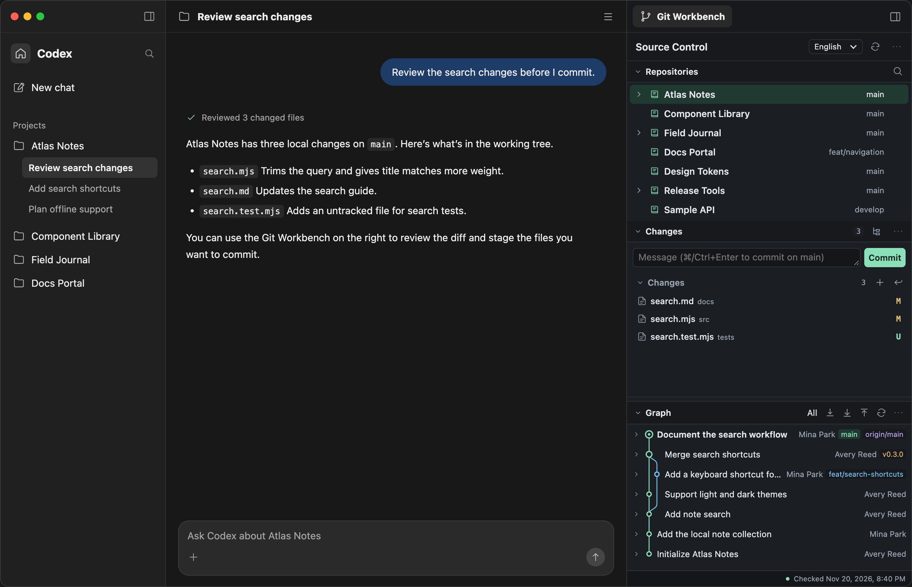
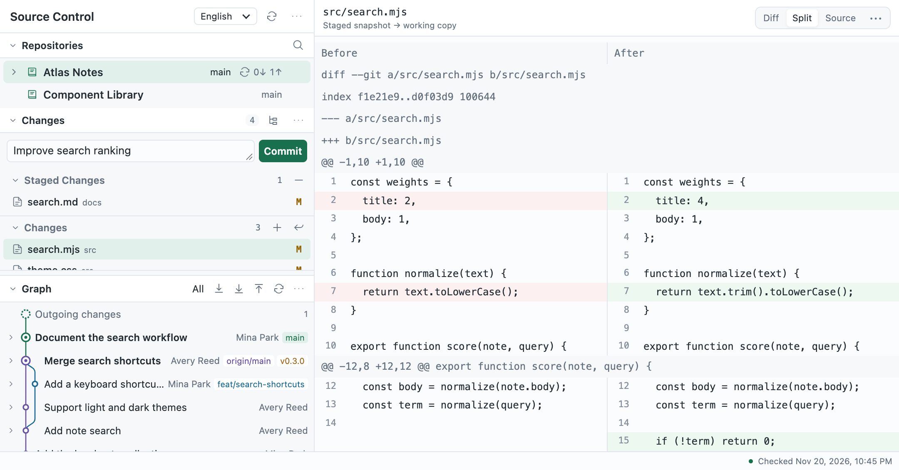
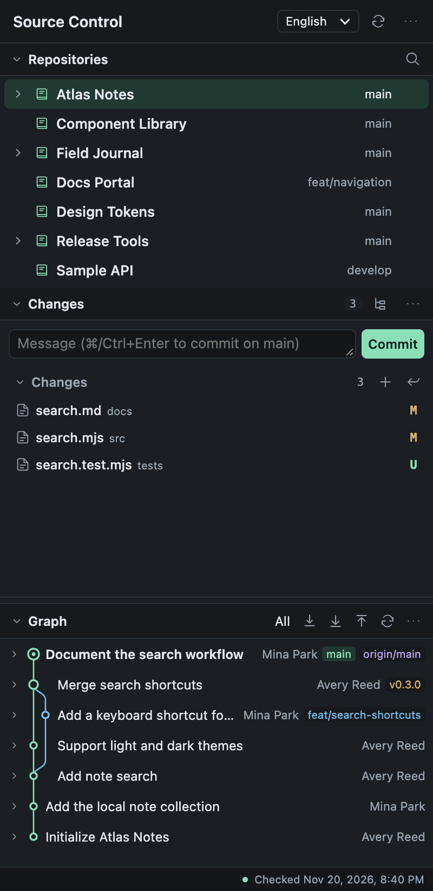

# Git Workbench for Codex

**English** · [简体中文](README.zh-CN.md)

A local Git workbench for Codex desktop. Review diffs, stage changes, and manage commits, branches, and worktrees.

[Quick start](#quick-start) · [Features](#features) · [Changelog](CHANGELOG.md) · [Report an issue](https://github.com/KissFeng/codex-git-workbench/issues) · [Contribute](CONTRIBUTING.md)

Docs, translations, compatibility reports, and code PRs are welcome. Small fixes can go straight to a PR. For larger changes, open an issue so we can agree on the scope first.



*Git Workbench beside a Codex chat. The projects, conversation, and Git data shown are fictional.*

## Quick start

You'll need Codex desktop with local MCP Apps support, Git 2.35 or later, and Node.js 24 or later. Make sure `git` and `node` are on your PATH. The plugin has no npm dependencies.

Install [v0.8.1](https://github.com/KissFeng/codex-git-workbench/releases/tag/v0.8.1) from GitHub.

```sh
codex plugin marketplace add KissFeng/codex-git-workbench --ref v0.8.1
codex plugin add codex-git-workbench@kissfeng-git-tools
```

Open **Git Workbench** from the panel picker. When Codex provides a chat with a Git working directory, the workbench selects that checkout. You can look up saved projects and worktrees or open another checkout from the repository picker.

In v0.8.1, enter your checkout’s absolute path in the repository picker. The native folder picker and the menu actions to open a file or its containing folder are available on `main` and are pending release. See the [v0.8.1 README](https://github.com/KissFeng/codex-git-workbench/blob/v0.8.1/README.md) for the features in this release.

### Installation troubleshooting

- **Git Workbench is missing.** Run `codex plugin list --marketplace kissfeng-git-tools` to check that the plugin is installed, then fully quit and reopen Codex. Use a Codex desktop version with local MCP Apps support.
- **Codex cannot find Node.js or Git.** Run `node --version` and `git --version`. If either command is missing or the plugin still fails to start, make sure the folder containing the executable is on the PATH available to the desktop app, then reopen Codex.
- **The old version still appears.** The install command pins a Git tag. To switch versions, use the desired tag in the marketplace command and run the plugin install command again. If Codex reports that the marketplace is already configured, run `codex plugin marketplace remove kissfeng-git-tools` first. Fully quit and reopen Codex after installing.

The desktop development environment is macOS. CI runs Node.js and Git tests on macOS and Linux. [Desktop compatibility reports](https://github.com/KissFeng/codex-git-workbench/issues) for Windows and Linux are welcome. Include your OS, Codex version, plugin tag, and steps to reproduce.

## Features

| Workflow | What you can do |
| --- | --- |
| Repositories | Find saved Codex projects and linked worktrees, choose a folder on macOS or Windows, initialize a repository, or clone with optional submodules. Enter an absolute path when the folder picker is unavailable. |
| Review and stage changes | Browse changes as a list or tree. View source, unified or split diffs, and image snapshots. Stage or unstage files, groups, hunks, or selected lines. Discard tracked edits or remove untracked files after confirmation. Ignore, rename, or delete files. |
| Commit | Commit staged or all changes, amend, create an empty commit, or undo an unpublished commit. Commit options include all-file amend, restoring the commit template, signing, sign-off, and skipping hooks. |
| Explore history | Filter the commit graph by branch, tag, or other ref. Expand commits to see their files, locate HEAD, compare refs or the working copy, and review incoming and outgoing changes from their common base. Follow file history and inspect line attribution. |
| Branches and remotes | Switch local or tracked remote branches, check out detached revisions, manage branches, tags, and remotes, and fetch, pull, push, publish, or sync. Sync defaults to fast-forward only, with options for rebase sync and pushing reachable annotated tags. Force pushes use a lease tied to the selected remote tip. |
| Conflicts, stashes, and worktrees | Compare base, ours, theirs, and working copy versions of a conflict. Edit and stage eligible results or select a version. Continue or abort a merge, rebase, or cherry-pick. Create, inspect, apply, pop, or drop stashes. Create or remove worktrees and move pending changes between them. |

## Using the panel

- **Layout.** Repositories, Changes, and Graph share one panel. Collapse sections or drag either divider to resize its neighboring sections. On narrow panels, **Back** returns from the preview to the same row and scroll position.
- **Actions.** Hover over a row for shortcuts, or open its context menu with a right-click or **Shift+F10**. On macOS and Windows, the file menu can open a file or its containing folder. The primary action follows the checkout state, with controls for commits, sync, and conflicts. Press **Cmd/Ctrl+Enter** in the commit message field to start the commit flow.
- **Language.** Use the selector in the **Source Control** header to switch between Simplified Chinese and English. The panel starts in Simplified Chinese and remembers your selection. Repository names, paths, and Git content keep their original text.

### Wide layout



*Wide layout with a split diff, using sample repository data.*

### Narrow side panel

<p align="center">
  
</p>

*Narrow side panel in dark mode, using sample repository data.*

Git uses your local hooks, credentials, signing, and remotes. When a write requires confirmation, the panel shows the target first. If a sync fails during the pull, it stops before pushing.

Use whole-file actions for binary files, symbolic links, renames, and permission changes. File and image previews have size limits. Commit message generation, GitHub sign-in, and pull request management are separate integrations.

## Development

Register a local checkout as a marketplace from the repository root, then install the plugin.

```sh
codex plugin marketplace add "$PWD"
codex plugin add codex-git-workbench@kissfeng-git-tools
```

Run `npm test` with Node.js 24 or later. The suite uses temporary local repositories and bare remotes to test staging, commits, conflicts, remotes, history, path handling, Codex project discovery, and the packaged MCP resource. CI runs on macOS and Linux.

The JavaScript panel follows Codex's light and dark themes and talks to a local MCP service over stdio. File, history, and Git mutation tools are available only to the panel. Git commands run in the selected checkout, and linked worktrees share a write queue keyed by their common Git directory.

## License and credits

Licensed under [MIT](LICENSE). The plugin is based on [Source Control for Codex v0.5.1](https://github.com/saltnpixels/codex-source-control/tree/v0.5.1) and preserves its license and Git history. Its own marketplace and plugin identifiers let it coexist with the upstream plugin.

Git workflows draw on the [VS Code Git extension](https://github.com/microsoft/vscode/tree/748f712f3050ae8f29d8af75ad560d7a88ac3322/extensions/git). See the [third-party notices](plugins/source-control-proof/THIRD_PARTY_NOTICES.md) for the adapted Code - OSS graph logic.
