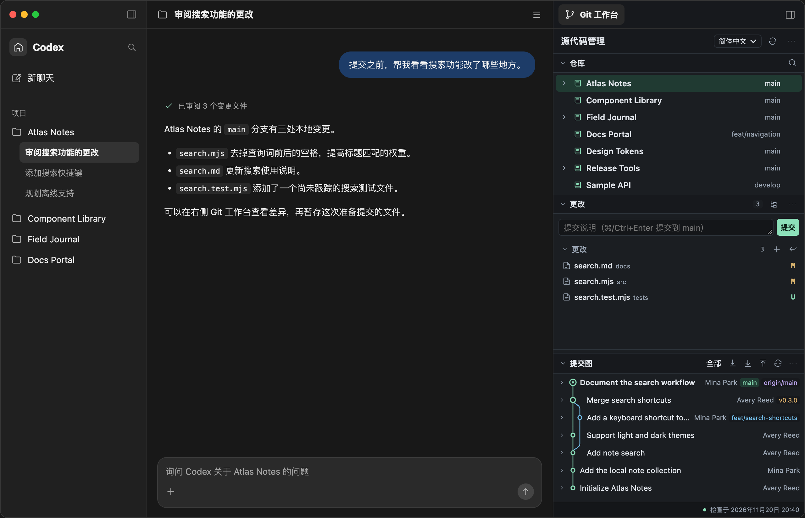
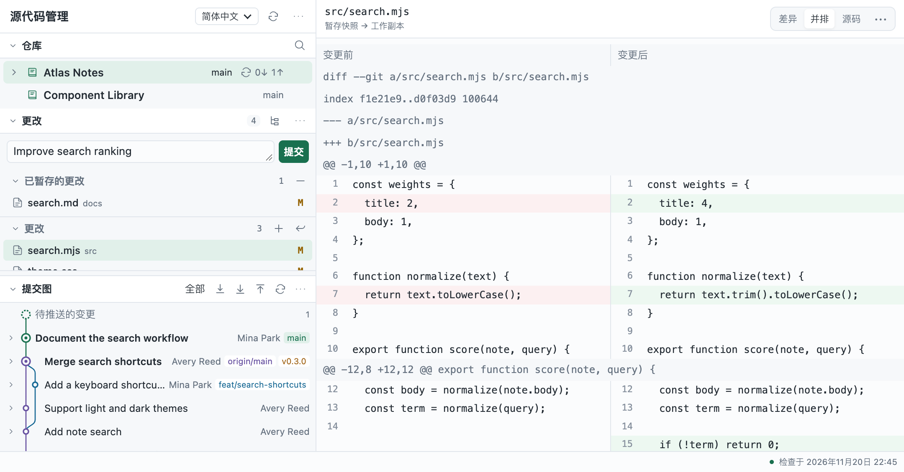
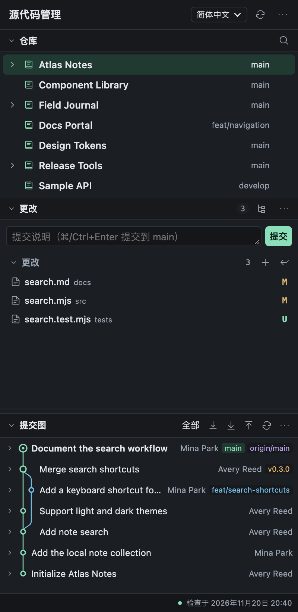

# Codex & Antigravity Git 工作台

[English](README.md) · **简体中文**

面向 Codex 桌面端与 Antigravity 2.0 的本地 Git 工作台。查看差异、暂存更改，并管理提交、分支和工作树。

[快速开始](#快速开始) · [功能](#功能) · [更新日志](CHANGELOG.md) · [反馈问题](https://github.com/KissFeng/git-workbench/issues) · [参与贡献](CONTRIBUTING.md#参与贡献)

欢迎贡献文档、翻译、兼容性反馈和代码 PR。小修可以直接提 PR，较大的改动请先开 Issue，一起确认范围。



*Git 工作台与 Codex 聊天并排展示。图中的项目、对话和 Git 数据均为虚构示例。*

## 快速开始

需要支持本地 MCP Apps 的 **Codex 桌面端** 或 **Antigravity 2.0**、Git 2.35 或更高版本，以及 Node.js 22+（推荐 24+）。请确保 `git` 和 `node` 在 PATH 中。插件无需安装 npm 依赖。

### 一键自适配安装（自动识别 Codex / Antigravity）

运行下面一条命令，会自动检测本机安装的 Codex / Antigravity 并安装对应插件（两者都装时会自动同时安装）：

**macOS / Linux：**

```sh
curl -fsSL https://raw.githubusercontent.com/KissFeng/git-workbench/main/install.sh | sh
```

**Windows (PowerShell)：**

```powershell
irm https://raw.githubusercontent.com/KissFeng/git-workbench/main/install.ps1 | iex
```

也支持通过 `--codex`、`--antigravity`、`--all`、`--ref <tag>` 手动指定目标或版本（例如 `curl -fsSL .../install.sh | sh -s -- --antigravity`）。

### 手动安装

**Codex 桌面端**（从 GitHub 安装 [v0.9.0](https://github.com/KissFeng/git-workbench/releases/tag/v0.9.0)）：

```sh
codex plugin marketplace add KissFeng/git-workbench --ref v0.9.0
codex plugin add codex-git-workbench@kissfeng-git-tools
```

**Antigravity 2.0**（本地克隆仓库后执行）：

```sh
npm run install:antigravity
```

- 在 **Codex** 中，从面板选择器打开 **Git Workbench**。当前聊天关联 Git 工作目录时会自动选中对应工作副本。
- 在 **Antigravity 2.0** 中，在右侧辅助面板打开 **Git Workbench**（可在 **Customizations → antigravity-git-workbench** 管理开关）。工作台会自动跟随当前对话工作区与宿主深浅主题。

也可以从仓库选择器查找已保存的项目和工作树，或打开其他工作副本。

在 macOS 和 Windows 上，可以用原生文件夹选择器打开工作副本，也可以通过文件菜单打开文件或其所在文件夹。仓库选择器也支持输入工作副本的绝对路径。

### 安装排障

- **找不到 Git Workbench 面板。** 运行 `codex plugin list --marketplace kissfeng-git-tools` 检查插件是否已安装，然后完全退出并重新打开 Codex。请使用支持本地 MCP Apps 的 Codex 桌面端。
- **Codex 找不到 Node.js 或 Git。** 运行 `node --version` 和 `git --version`。如果命令找不到，或插件仍然无法启动，请确认可执行文件所在目录在桌面端能读到的 PATH 中，再重启 Codex。
- **升级后仍显示旧版本。** 安装命令固定了 Git tag。切换版本时，在添加插件市场的命令中填写目标 tag，再运行插件安装命令。如果 Codex 提示市场已配置，先执行 `codex plugin marketplace remove kissfeng-git-tools`。安装后完全退出并重新打开 Codex。

桌面端开发环境为 macOS。CI 在 macOS 和 Linux 上运行 Node.js 和 Git 测试。欢迎提交 Windows 和 Linux 的[桌面端兼容性反馈](https://github.com/KissFeng/git-workbench/issues)，请附上系统、Codex 或 Antigravity 版本、插件 tag 和复现步骤。

## 功能

| 工作流程 | 支持的操作 |
| --- | --- |
| 仓库 | 查找已保存的 Codex 项目和关联工作树，在 macOS 或 Windows 上选择文件夹，初始化仓库，或在克隆时选择是否拉取子模块。文件夹选择器不可用时可输入绝对路径。 |
| 查看与暂存更改 | 用列表或树形视图浏览更改，查看源文件、统一或并排差异以及图片快照。按文件、分组、差异块或选中行暂存和取消暂存。丢弃已跟踪文件的更改，或在确认后移除未跟踪的文件。也可以忽略、重命名或删除文件。 |
| 提交 | 提交已暂存或全部更改，修订上一次提交，创建空提交，或撤销尚未发布的提交。提交选项包括带上全部文件进行修订、恢复提交模板、签名、添加 Signed-off-by 和跳过钩子。 |
| 提交历史 | 按分支、标签或其他引用筛选提交图。展开提交查看文件，定位 HEAD，比较引用或工作副本，并以共同祖先为基准查看传入和传出更改。查看文件历史和逐行归属。 |
| 分支与远程 | 切换本地分支或跟踪远程分支，检出游离 HEAD，管理分支、标签和远程仓库，执行抓取、拉取、推送、发布或同步。同步默认仅允许快进，也可以选择变基同步或同时推送可达的附注标签。强制推送会校验此前选定的远程分支提交。 |
| 冲突、贮藏与工作树 | 对比冲突文件的基准、本方、对方和工作副本。编辑并暂存支持的结果，或选用其中一个版本。继续或中止合并、变基和拣选提交。创建、查看、应用、弹出或删除贮藏。创建或移除工作树，并在工作树之间转移待处理更改。 |

## 使用面板

- **布局。** 仓库、更改和提交图显示在同一面板。可以折叠各区域，也可以拖动任一分隔线调整相邻区域的高度。在窄面板中，从预览点击**返回**可回到原来的条目和滚动位置。
- **操作。** 悬停在条目上可显示快捷操作，也可右键或按 **Shift+F10** 打开菜单。在 macOS 和 Windows 上，文件菜单可以打开文件或所在文件夹。主按钮会根据当前检出状态提供提交、同步或冲突处理操作。在提交信息框中按 **Cmd/Ctrl+Enter** 可发起提交流程。
- **语言。** 在**源代码管理**标题栏中切换简体中文或英文。面板初始使用简体中文，并记住你的选择。仓库名、路径和 Git 内容保留原文。

### 宽面板



*宽面板的并排差异视图，使用示例仓库数据。*

### 窄侧栏

<p align="center">
  
</p>

*深色主题下的窄侧栏，使用示例仓库数据。*

插件使用本机 Git 的钩子、凭据、签名和远程配置。需要确认的写入操作会先在面板中显示目标。同步时如果拉取失败，流程会在推送前停止。

二进制文件、符号链接、重命名和权限变更需要按整个文件操作。文件和图片预览有大小限制。提交信息生成、GitHub 登录和 Pull Request 管理由独立集成提供。

## 本地开发

在仓库根目录注册本地插件市场，然后安装插件。

```sh
codex plugin marketplace add "$PWD"
codex plugin add codex-git-workbench@kissfeng-git-tools
```

使用 Node.js 24 或更高版本运行 `npm test`。测试使用临时本地仓库和裸仓库，覆盖暂存、提交、冲突、远程操作、提交历史、路径处理、Codex 项目发现和打包后的 MCP 资源。CI 在 macOS 和 Linux 上运行。

JavaScript 面板跟随 Codex 的浅色和深色主题，通过标准输入输出与本地 MCP 服务通信。文件、历史和 Git 写入工具仅供面板调用。Git 命令在选中的检出目录中执行，共用 Git 目录的关联工作树共享写入队列。

## 许可证与致谢

项目采用 [MIT 许可证](LICENSE)，基于 [Source Control for Codex v0.5.1](https://github.com/saltnpixels/codex-source-control/tree/v0.5.1)，保留了上游的许可证和 Git 历史。独立的插件市场和插件标识符允许两个版本同时安装。

Git 工作流程参考了 [VS Code 内置 Git 扩展](https://github.com/microsoft/vscode/tree/748f712f3050ae8f29d8af75ad560d7a88ac3322/extensions/git)。改编自 Code - OSS 的提交图逻辑见[第三方声明](plugins/source-control-proof/THIRD_PARTY_NOTICES.md)。
